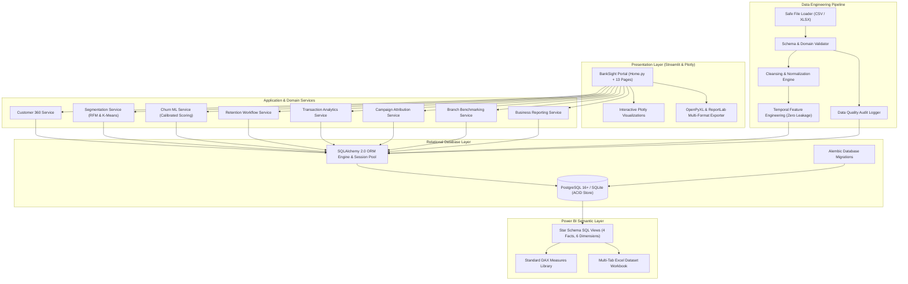
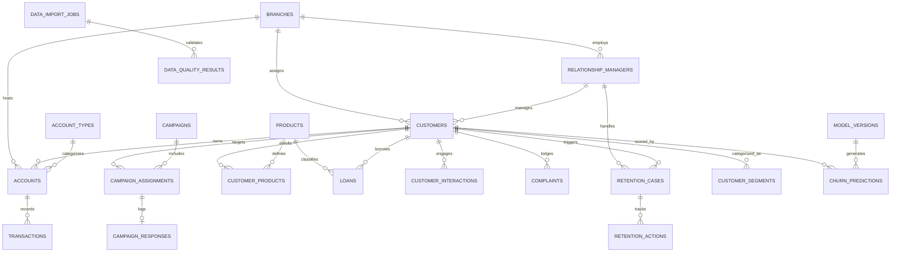

# BankSight — Banking Customer Intelligence & Retention Platform

[](https://github.com/Livesh-L-28/banksight/actions/workflows/ci.yml)
[](https://www.python.org/)
[](https://www.postgresql.org/)
[](https://opensource.org/licenses/MIT)
[](https://github.com/astral-sh/ruff)
[](https://pytest.org/)

---

## 1. Project Title & Description
**BankSight** is an enterprise-grade Banking Customer Intelligence & Retention Platform designed to empower retail and commercial banking executives, branch managers, retention officers, and data analysts with comprehensive customer 360 intelligence, multi-dimensional segmentation, machine learning churn prediction with explainability, closed-loop retention workflow management, and Power BI semantic analytics.

---

## 2. Project Overview
Modern retail banks operate in an environment characterized by aggressive fintech competition, high customer acquisition costs, and margin compression. BankSight bridges the gap between descriptive portfolio reporting and predictive frontline action. By unifying transactional ledgers, customer service interactions, deposit volatility, and predictive models into an auditable closed-loop system, BankSight allows institutions to detect defection signals 60–90 days in advance and execute personalized retention interventions with measurable ROI.

---

## 3. Banking Industry Problem Statement
- **Reactive Churn Mitigation:** Banks traditionally react to attrition only after account closure paperwork is filed or balances are depleted to near-zero.
- **Data Fragmentation:** Customer financial holdings, transaction velocity, complaints, and branch interactions reside in disconnected core-banking and CRM silos.
- **Crude Segmentation:** Static demographic or arbitrary balance brackets fail to capture behavioral cadence, digital adoption, and RFM dynamics.
- **Opaque Black-Box Models:** Frontline Relationship Managers (RMs) mistrust machine learning scores that lack explainable contributing drivers and tailored action playbooks.
- **Ad-Hoc Spreadsheet Workflows:** Retention campaigns are managed across disconnected spreadsheets lacking audit trails, SLA monitoring, and outcome tracking.

---

## 4. Business Objectives & Target Metrics
- **Attrition Reduction:** Lower annualized retail portfolio churn rate by 300 to 500 basis points within 12 months.
- **Retention Conversion:** Achieve $\ge 35\%$ conversion on high-risk customer retention interventions.
- **Deposit Capital Protection:** Preserve at least $25M in annual retail deposits through preemptive interventions.
- **Cross-Selling Expansion:** Elevate products per customer from 1.6 to 2.4 across core depository accounts.
- **Operational Efficiency:** Eliminate manual monthly reporting overhead with real-time dynamic KPI calculations (<1.5s latency).

---

## 5. Target Stakeholders & Personas
- **Executive Leadership (CEO, CRO, Head of Retail Banking):** Macro portfolio health, capital allocation, attrition trends, and Net Interest Margin preservation.
- **Retention Managers:** High-risk priority queues, retention funnel analytics, and incentive budget allocation.
- **Relationship Managers (RMs):** Unified customer 360 dossiers, root-cause churn drivers, and customer consultation logging.
- **Branch Managers:** Branch benchmarking, deposit growth rankings, dormancy alerts, and regional comparisons.
- **Marketing Campaign Managers:** Audience segmentation, campaign ROI attribution, and acquisition cost optimization.
- **Banking Data Analysts & BI Teams:** Star-schema analytical tables, automated pipeline validation, and Power BI DAX semantic models.

---

## 6. Key Features & Functional Modules

| Module | Core Functionality |
|---|---|
| **1. Executive Dashboard** | 15 dynamic banking KPIs (Deposits, Churn, Retention, ARPU, CLV), monthly cashflow trends, segment donut share, branch ranking, and cohort drill-down export. |
| **2. Customer 360** | Multi-account balances (checking/savings/CDs), lending facilities, recent transaction ledgers, customer complaints log, and chronological timeline. |
| **3. Customer Segmentation** | RFM quintile scoring (1-5), unsupervised K-Means clustering with empirical centroid profiling, demographic age bands, and financial balance tiers. |
| **4. Churn Intelligence** | Multi-model benchmarking (Logistic Regression, Random Forest, Gradient Boosting), calibrated probabilities, ROC/PR curves, and factor attributions. |
| **5. Retention Management** | Operational case lifecycle (`Identified` $\to$ `Assigned` $\to$ `Contacted` $\to$ `Offer Proposed` $\to$ `Retained`), RM assignment, and retention funnel. |
| **6. Transaction Analytics** | Channel breakdown (Mobile, Online, POS, ATM, Branch), spending categories, dormant account flags (>90 days), and ledger reconciliation audits. |
| **7. Campaign Intelligence** | Campaign lifecycle, multi-touch revenue attribution modeling, marketing ROI, and Cost Per Acquisition (CPA). |
| **8. Branch Analytics** | Branch rankings by deposits, customer growth, attrition rates, regional comparisons, and underperforming unit alerts. |
| **9. Product Intelligence** | Catalog penetration, portfolio depth, and transparent rule-based cross-sell recommendations (CDs, Premium Cards, Loans). |
| **10. Business Reporting** | On-demand export of 8 standard executive reports in CSV, styled Excel (.xlsx), and audit-ready PDF formats. |
| **11. Data Management** | File ingestion, schema validation, boundary checks, duplicate detection, and data quality execution logs. |
| **12. Model Management** | MLOps model registry, version tracking, champion-challenger lineage, and feature importance governance. |
| **13. Platform Settings** | Database connectivity audit, operational risk threshold calibration, and system integrity verification. |

---

## 7. System Architecture Blueprint



---

## 8. Technology Stack Reference

- **Programming Language:** Python 3.12+
- **Data Engineering & Numerics:** Pandas 2.2+, NumPy 1.26+, OpenPyXL 3.1+
- **Database & Persistence:** PostgreSQL 16+, SQLAlchemy 2.0+, Alembic 1.13+, SQLite 3.35+
- **Machine Learning & Analytics:** Scikit-learn 1.4+, Joblib 1.3+, SHAP 0.49+
- **Web Application & UI:** Streamlit 1.32+, Plotly 5.19+, HTML/CSS Custom Components
- **Reporting Engine:** ReportLab 4.1+, OpenPyXL 3.1+
- **Semantic BI Layer:** Power BI Star Schema, ANSI-SQL Views, DAX Expressions
- **Testing & Quality:** Pytest 8.0+, Pytest-Cov 4.1+, Ruff 0.3+
- **DevOps & Infrastructure:** Docker, Docker Compose v2, GitHub Actions CI/CD

---

## 9. Database Entity Relationship Diagram (ERD)



---

## 10. Data Engineering Pipeline
The pipeline enforces a 7-stage architecture to ensure referential integrity, range safety, and auditability:
1. **Raw Ingestion:** Reads CSV and Excel files with size cap checks ($\le 25\text{MB}$) and extension verification.
2. **Schema & Range Validation:** Enforces positive amounts, adult age brackets ($18 \le \text{age} \le 115$), and valid ISO date structures.
3. **Data Quality Audit:** Isolates invalid or duplicate rows into `data/exports/rejected_records.csv` with explicit root-cause notes. Never silently discards data.
4. **Cleansing & Normalization:** Standardizes text casing (e.g. 2-letter uppercase states, title-cased cities) and formats numeric currency values.
5. **Relational Persistence:** Loads cleaned batches into relational tables using SQLAlchemy 2.0 transactions.
6. **Temporal Feature Engineering:** Computes RFM quintiles, 90-day balance trend ratios, transaction frequency, and complaint histories strictly prior to cutoff date $T$ to eliminate data leakage.
7. **Semantic Serving:** Updates star schema views and analytical caches for dashboard and Power BI consumption.

---

## 11. Customer Segmentation Methodology
BankSight supports multi-dimensional customer segmentation:
- **RFM Quintile Scoring:**
  - *Recency (R):* Days elapsed since last debit transaction (Quantiles 1–5; 5 = most recent).
  - *Frequency (F):* Number of transactions in trailing 12 months (Quantiles 1–5; 5 = highest frequency).
  - *Monetary (M):* Cumulative balance and spend volume (Quantiles 1–5; 5 = highest monetary value).
  - Assigns 8 strategic cohorts: `High Value`, `Loyal Customers`, `High Growth Potential`, `New Customers`, `At Risk`, `Dormant`, `Potential Loyalists`, and `Low Engagement`.
- **K-Means Unsupervised Behavioral Clustering:**
  - Normalized feature vectors: `total_balance`, `annual_income`, `txn_frequency_12m`, `customer_tenure_months`, `digital_txn_ratio`, `recency_days`.
  - Configurable cluster parameter $k \in [3, 8]$ with silhouette score evaluation.
  - Empirical Centroid Profiling: Assigns human-readable business labels (`Wealth & Affluent Savers`, `Active Digital Transactors`, `Dormant Traditionalists`, `Emerging Everyday Retail`) based on measured centroid metrics, never arbitrary digits.

---

## 12. Churn Prediction & Explainability
- **Temporal Cutoff:** Features are engineered strictly prior to observation point $T$; zero future data leakage.
- **Model Benchmark:** Stratified 80/20 train/test evaluation across:
  - *Logistic Regression:* L2 penalized with balanced class weights and standardized features.
  - *Random Forest:* 120 estimators, depth 8, balanced class weighting.
  - *Gradient Boosting:* 100 estimators, learning rate 0.08, max depth 4 (Champion model, ROC-AUC $\ge 0.82$).
- **Calibrated Risk Tiers:**
  - `High Risk`: $P(\text{churn}) > 0.65$ $\to$ Auto-enrolls into operational retention queue.
  - `Medium Risk`: $0.35 \le P(\text{churn}) \le 0.65$ $\to$ Eligible for automated digital retention nurture.
  - `Low Risk`: $P(\text{churn}) < 0.35$ $\to$ Standard servicing and product cross-selling.
- **Explainability Attribution:** Computes top feature drivers per customer (e.g., balance drop $>30\%$, inactivity $>45$ days, unaddressed complaints) paired with advisory retention recommendations.

---

## 13. Operational Retention Management Workflow
Retention cases follow an auditable lifecycle:
$$\text{Identified} \longrightarrow \text{Assigned} \longrightarrow \text{Contacted} \longrightarrow \text{Offer Proposed} \longrightarrow \text{Retained / Not Retained} \longrightarrow \text{Closed}$$
- High-risk accounts are auto-enrolled or manually opened.
- Relationship Managers log interaction notes, propose targeted offers (fee waivers, CD rate boosts, private banker assignment), and record outcomes.
- All transitions persist to `retention_cases` and `retention_actions` tables in the database with user attribution and timestamps.

---

## 14. Key Performance Indicators (KPI) Directory

| Metric | Mathematical Formula | SQL / Computation Logic | Business Interpretation |
|---|---|---|---|
| **Total Customers** | $N = \sum \mathbf{1}_{c \in \text{Customers}}$ | `COUNT(DISTINCT customer_id)` | Macro size of customer portfolio |
| **Customer Churn Rate** | $R_{\text{churn}} = \frac{N_{\text{churned}}}{N_{\text{total}}} \times 100\%$ | `COUNT(CASE WHEN churn_flag = 1) / COUNT(*)` | Annualized portfolio attrition rate |
| **Customer Retention Rate** | $R_{\text{ret}} = 100\% - R_{\text{churn}}$ | `100.0 - churn_rate_pct` | Relationship durability metric |
| **Total Deposits** | $V_{\text{dep}} = \sum \text{amount}_{\text{deposit}}$ | `SUM(amount) WHERE type = 'Deposit'` | Total customer funds held in trust |
| **Average Customer Balance** | $\bar{B} = \frac{\sum \text{current\_balance}}{N_{\text{active}}}$ | `SUM(current_balance) / active_customers` | Capital depth per relationship |
| **ARPU (Annual)** | $\text{ARPU} = 2.5\% \times \bar{B} + \$120$ | `0.025 * avg_balance + 120.0` | Net interest spread plus annual fees |
| **Customer Lifetime Value** | $\text{CLV} = \frac{\text{ARPU} \times 0.75}{R_{\text{churn}} + 0.08}$ | `(arpu * 0.75) / (churn_rate + 0.08)` | Projected net present customer value |
| **Campaign ROI** | $\text{ROI} = \frac{\text{Attributed Rev} - \text{Cost}}{\text{Cost}} \times 100\%$ | `(revenue - budget) / budget * 100` | Net marketing return per dollar spent |

---

## 15. Power BI Integration & Semantic Layer
BankSight includes a dedicated Power BI analytics layer:
- **Star Schema Views:** `powerbi/sql_views/star_schema_views.sql` (FactTransactions, FactCustomerSnapshot, FactCampaign, FactRetention, DimCustomer, DimDate, DimBranch, DimProduct, DimAccount).
- **DAX Measures:** Complete library in `powerbi/dax/measures.dax` covering portfolio KPIs, time intelligence, and acquisition rates.
- **Export Datasets:** CSV datasets and a multi-tab Excel model `powerbi/datasets/BankSight_PowerBI_Star_Schema.xlsx`.
- **Implementation Guide:** Step-by-step connection, relationship mapping, and canvas design guide in `powerbi/documentation/powerbi_guide.md`.

---

## 16. Installation & Quickstart

### Prerequisites
- Python 3.12+ (64-bit)
- Git
- Docker & Docker Compose (Optional for container deployment)

### 1. Local Setup
```bash
# Clone the repository
git clone https://github.com/Livesh-L-28/banksight.git
cd banksight

# Create and activate Python virtual environment
python3 -m venv .venv
source .venv/bin/activate  # On Windows: .venv\Scripts\activate

# Install pinned dependencies
pip install --upgrade pip
pip install -r requirements.txt

# Configure environment variables
cp .env.example .env
```

### 2. Database Initialization & Data Pipeline
```bash
# Initialize relational database schema
python scripts/init_db.py

# Generate high-fidelity synthetic banking dataset (1,000 customers, 54k transactions)
python scripts/generate_synthetic_data.py

# Seed database with referential consistency
python scripts/seed_database.py

# Export Power BI Star Schema datasets
python scripts/export_powerbi_data.py
```

### 3. Launch Application
```bash
streamlit run app/Home.py
```
Open your browser to `http://localhost:8501`.

---

## 17. Docker Deployment
BankSight supports a multi-container Docker deployment featuring PostgreSQL 16 Alpine and the Streamlit application:

```bash
# Start PostgreSQL database and BankSight application
docker-compose up --build -d

# Check container status
docker-compose ps

# Stop containers
docker-compose down
```

Access the application at `http://localhost:8501`.

---

## 18. Testing & Code Quality Verification

BankSight includes 31 automated tests covering unit models, data validation, ML training, and end-to-end integration:

```bash
# Run complete test suite
pytest -v

# Run with coverage report
pytest --cov=backend --cov=analytics --cov=data_pipeline

# Run Ruff linter check
ruff check .
```

---

## 19. Security, Privacy & Compliance Standards
- **Zero Real PII Mandate:** All customer identities, telephone numbers, emails, account numbers, and transactions are 100% synthetically generated.
- **SQL Injection Immunization:** All queries use SQLAlchemy 2.0 ORM expressions or parameterized binds; zero string concatenation.
- **Environment Isolation:** Secrets and database connection strings are managed via `.env` with strict `.gitignore` exclusion.
- **Advisory AI Governance:** Machine learning churn probabilities and cross-sell suggestions are advisory; human authorization is mandatory before client outreach.

---

## 20. Repository Structure

```
banksight/
|-- app/
|   |-- Home.py                            # Application Gateway & Executive Portal
|   |-- components/
|   |   |-- ui_components.py               # Deep navy styling, KPI cards, Plotly themes
|   |-- pages/
|   |   |-- 01_Overview.py                 # Module 1: Executive Intelligence Dashboard
|   |   |-- 02_Customer_360.py             # Module 2: Customer 360 Dossiers
|   |   |-- 03_Segmentation.py             # Module 3: RFM & K-Means Segmentation
|   |   |-- 04_Churn_Intelligence.py       # Module 4: Predictive Churn Machine Learning
|   |   |-- 05_Retention_Management.py     # Module 5: Operational Retention Workflows
|   |   |-- 06_Transaction_Analytics.py    # Module 6: Omnichannel & Spending Analytics
|   |   |-- 07_Campaign_Intelligence.py    # Module 7: Campaign Attribution & ROI
|   |   |-- 08_Branch_Analytics.py         # Module 8: Branch Performance Benchmarking
|   |   |-- 09_Product_Intelligence.py     # Module 9: Product Penetration & Cross-Sell
|   |   |-- 10_Reports.py                  # Module 10: Multi-Format Business Reports
|   |   |-- 11_Data_Management.py          # Module 11: File Ingestion & Quality Audit
|   |   |-- 12_Model_Management.py         # Module 12: MLOps Model Version Registry
|   |   |-- 13_Settings.py                 # Module 13: Platform Settings & Diagnostics
|
|-- backend/
|   |-- database/                          # Connection pooling, engine, session factory
|   |-- models/                            # 21 SQLAlchemy 2.0 declarative entities
|   |-- repositories/                      # KPI, Customer, Txn, Branch, Product, Retention
|   |-- services/                          # Business logic services
|   |-- migrations/                        # Alembic database migrations
|
|-- data/
|   |-- raw/                               # Raw uploaded ingestion files
|   |-- synthetic/                         # Generated synthetic banking datasets (14 CSVs)
|   |-- exports/                           # Rejected records and report outputs
|
|-- data_pipeline/
|   |-- ingestion/                         # Safe CSV/XLSX file loader
|   |-- validation/                        # Schema and domain boundary validator
|   |-- cleaning/                          # Cleansing and text normalization
|   |-- feature_engineering/               # Point-in-time feature extraction
|   |-- pipeline_manager.py                # Pipeline orchestrator
|
|-- analytics/
|   |-- segmentation/                      # RFM scoring and K-Means clustering
|   |-- churn/                             # Multi-model predictive pipeline & calibration
|
|-- powerbi/
|   |-- datasets/                          # Star Schema CSVs & Excel model workbook
|   |-- dax/                               # Standard DAX measures library
|   |-- sql_views/                         # Star Schema ANSI-SQL views (4 facts, 6 dims)
|   |-- documentation/                     # Power BI Desktop connection and design guide
|
|-- docs/
|   |-- architecture/                      # System architecture blueprints & data flow
|   |-- business-analysis/                 # 20 required Business Analysis documents (BRD, FRD, etc.)
|   |-- database/                          # Schema docs, ERD, indexing, queries, security
|
|-- scripts/
|   |-- init_db.py                         # Schema creation utility
|   |-- generate_synthetic_data.py         # High-fidelity synthetic dataset generator
|   |-- seed_database.py                   # Referential integrity database seed utility
|   |-- export_powerbi_data.py             # Power BI star schema export script
|
|-- tests/
|   |-- unit/                              # Unit tests (models, pipeline, KPIs, ML, Power BI)
|   |-- integration/                       # Full lifecycle integration workflow test
|   |-- e2e/                               # Application compilation smoke tests
|
|-- docker-compose.yml                     # Multi-container orchestration (Postgres + Streamlit)
|-- Dockerfile                             # Application container specification
|-- Makefile                               # Developer CLI commands
|-- requirements.txt                       # Pinned Python dependencies
|-- pyproject.toml                         # Ruff & Pytest configuration
|-- .env.example                           # Configuration template
|-- .gitignore                             # Version control exclusions
|-- LICENSE                                # MIT License
|-- CONTRIBUTING.md                        # Contribution guidelines
|-- SECURITY.md                            # Security policies & vulnerability disclosure
|-- CHANGELOG.md                           # Version release notes
|-- PHASE_STATUS.md                        # Phase-by-phase implementation tracker
|-- README.md                              # Master project documentation
```

---

## 21. Limitations & Future Roadmap
- **Analytical Scope:** BankSight is an analytical intelligence platform; it does not settle real-time ACH/Fedwire payments or file FinCEN regulatory forms.
- **Future Enhancements:**
  - Real-time Kafka / Event Hub streaming ingestion.
  - Automated causal inference & uplift modeling for retention campaigns.
  - LLM-powered relationship manager meeting briefing summaries.

---

## 22. License
This project is licensed under the MIT License — see the [LICENSE](file:///Users/livesh/BankSight/LICENSE) file for details.

