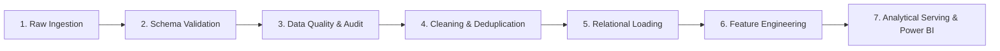

# BankSight Data Flow & Transformation Specification
## End-to-End Data Lineage & Pipeline Architecture
**Document Version:** 1.0.0  
**Date:** 2026-11-07  

---

## 1. End-to-End Data Pipeline Stages

The BankSight data engineering pipeline follows a disciplined 7-stage architecture guaranteeing data integrity, referential consistency, and zero data leakage:

### Stage 1: Raw Ingestion (`data/raw/` or API)
- Ingests tabular customer, account, transaction, campaign, and complaint files in CSV or XLSX formats.
- Supports batch loads and single file uploads through the Data Management UI.

### Stage 2: Schema & Type Validation
- Verifies column presence against strict Pydantic schemas.
- Validates data types (e.g. `customer_id` string pattern, `transaction_amount` positive numeric, ISO dates).
- Discards or flags non-conforming records; never silently alters erroneous data.

### Stage 3: Data Quality & Audit Logging
- Checks for duplicate transaction identifiers, broken foreign keys, out-of-range balances, and negative customer age values.
- Persists summary quality run metrics into `data_quality_results` table.
- Logs rejected rows with rejection reason into `data/exports/rejected_records.csv`.

### Stage 4: Cleaning & Normalization
- Standardizes string representations (uppercase state codes, trimmed city names).
- Normalizes transaction channel labels (`ATM`, `POS`, `ONLINE`, `MOBILE`, `BRANCH`).
- Imputes missing optional fields where statistically sound (or leaves null for referential clarity).

### Stage 5: Relational Persistence
- Inserts validated records into relational entities using SQLAlchemy 2.0 with foreign key enforcement.
- Manages transactional boundaries (`session.commit()` with rollback on failure).

### Stage 6: Temporal Feature Engineering (Zero Data Leakage)
- For every customer at point-in-time $T$:
  - Recency: Days since last debit transaction prior to $T$.
  - Frequency: Count of debit transactions in $[T - 365, T]$.
  - Monetary: Average monthly balance in $[T - 180, T]$.
  - Balance Trend: $\frac{\text{Avg Balance}_{[T - 90, T]}}{\text{Avg Balance}_{[T - 180, T - 91]} + \epsilon}$.
  - Complaints: Count of unresolved complaints prior to $T$.
  - Digital Ratio: $\frac{\text{Digital Transactions}}{\text{Total Transactions}}$.

### Stage 7: Analytical Serving & Semantic Layer
- Precomputes RFM quintiles, executes K-Means clustering, and generates calibrated churn predictions.
- Populates star schema views for Power BI (`FactTransactions`, `FactCustomerSnapshot`, `DimCustomer`, `DimDate`, `DimBranch`, `DimProduct`).
