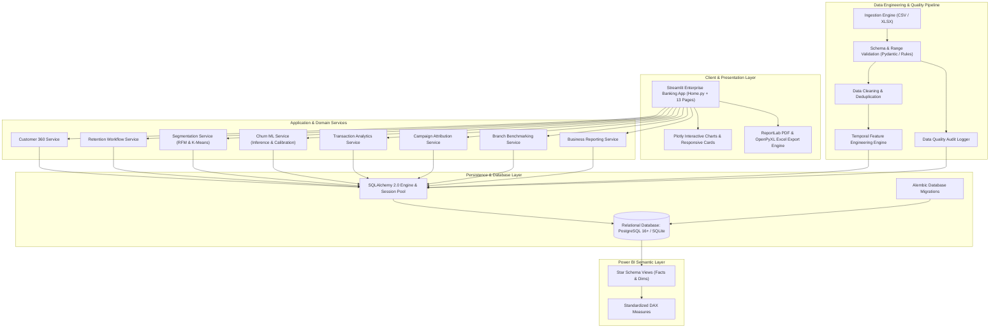

# BankSight Enterprise Architecture Blueprint
## High-Level System Design & Component Architecture
**Document Version:** 1.0.0  
**Date:** 2026-11-07  

---

## 1. Architectural Vision & Principles
BankSight is architected as a modular, decoupled banking intelligence and operational retention platform following clean architecture principles. It strictly separates concerns between:
1. **Presentation Layer:** Enterprise Streamlit UI with 13 functional pages and interactive Plotly visualization.
2. **Analytics & Machine Learning Layer:** Feature engineering, scikit-learn predictive pipelines, RFM, and K-Means segmentation.
3. **Domain & Application Services:** Business logic orchestration, validation, reporting, and retention workflows.
4. **Data Access & Persistence Layer:** Normalized relational database (PostgreSQL / SQLite) via SQLAlchemy 2.0 ORM and repository patterns.
5. **Data Pipeline Layer:** Ingestion, data quality rules, cleaning, transformation, and audit logging.

---

## 2. High-Level System Architecture Diagram

---

## 3. Technology Stack Reference Table

| Layer | Technologies Selected | Rationale |
|---|---|---|
| **Programming Language** | Python 3.12+ | High performance, modern typing, robust ecosystem for data science and web apps. |
| **User Interface** | Streamlit, Plotly, HTML/CSS Components | Rapid enterprise interactivity, real-time reactive re-rendering, deep financial color palettes. |
| **Data Processing** | Pandas, NumPy | Standard vectorized in-memory tabular manipulation and aggregations. |
| **Database & ORM** | PostgreSQL 16+, SQLAlchemy 2.0, Alembic | ACID-compliant relational persistence, declarative schemas, seamless SQLite fallback. |
| **Machine Learning** | Scikit-learn, Joblib, SHAP | Reliable production algorithms (Logistic Regression, Random Forest, Gradient Boosting), calibrated probabilities, and explainability. |
| **Reporting** | OpenPyXL, ReportLab | Native generation of styled Excel workbooks and audit-ready PDF documents. |
| **Semantic / BI** | Power BI Star Schema, DAX | Native corporate BI distribution and enterprise data democratization. |
| **Infrastructure & CI** | Docker, Docker Compose, GitHub Actions, Pytest, Ruff | Reproducible containerized execution, automated quality gates, zero regression. |

