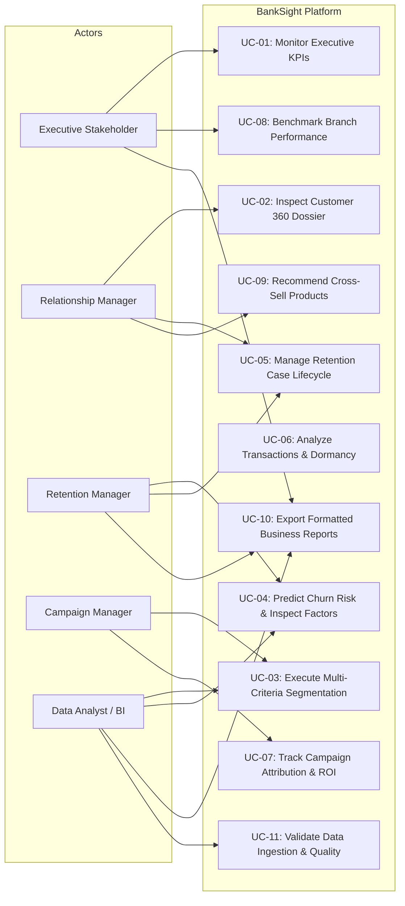

# Use Case Specifications & Diagrams
## Project Name: BankSight — Banking Customer Intelligence & Retention Platform
**Document Version:** 1.0.0  
**Date:** 2026-11-07  

---

## 1. System Actor Definitions
1. **Executive Stakeholder:** Reviews macroeconomic indicators, board reports, and cross-branch health.
2. **Retention Manager:** Enrolls high-risk accounts, schedules actions, and tracks retention outcomes.
3. **Relationship Manager (RM):** Interacts with clients, reviews customer 360 dossiers, logs case progress.
4. **Campaign Manager:** Configures campaigns, monitors response rates, and evaluates CAC/ROI.
5. **Data Analyst / BI Engineer:** Configures segmentation parameters, validates ML models, exports data.

---

## 2. High-Level Use Case Diagram

---

## 3. Detailed Use Case Scenario: UC-05 Manage Retention Case Lifecycle

| Attribute | Specification |
|---|---|
| **Use Case ID** | UC-05 |
| **Use Case Name** | Manage Retention Case Lifecycle |
| **Primary Actor** | Retention Manager & Relationship Manager |
| **Pre-Conditions** | Customer has been scored by ML churn model and classified as `High Risk` ($P(\text{churn}) > 0.65$). |
| **Trigger** | Retention Manager reviews the high-risk queue or system flags a newly deteriorating account. |
| **Main Success Scenario** | 1. Retention Manager identifies high-risk customer CUST-1049. 2. System displays top churn drivers (e.g. 35% balance decline, recent unresolved complaint). 3. Retention Manager creates a new Retention Case and assigns it to RM Jane Doe with a target follow-up date. 4. Case transitions to status `Assigned`. 5. RM Jane Doe contacts customer, proposes an advisory retention offer (e.g. 3-month fee waiver, high-yield deposit promotion). 6. RM updates case status to `Contacted` and subsequently `Offer Proposed`. 7. Customer accepts offer and maintains active balance; RM updates status to `Retained` with closing notes. 8. System updates retention performance metrics in real-time. |
| **Post-Conditions** | Retention case is persisted with full audit history in `retention_cases` and `retention_actions` tables. |
| **Alternative Flows** | 7a. Customer declines offer and moves to competitor; RM updates status to `Not Retained` with defection reason. |

