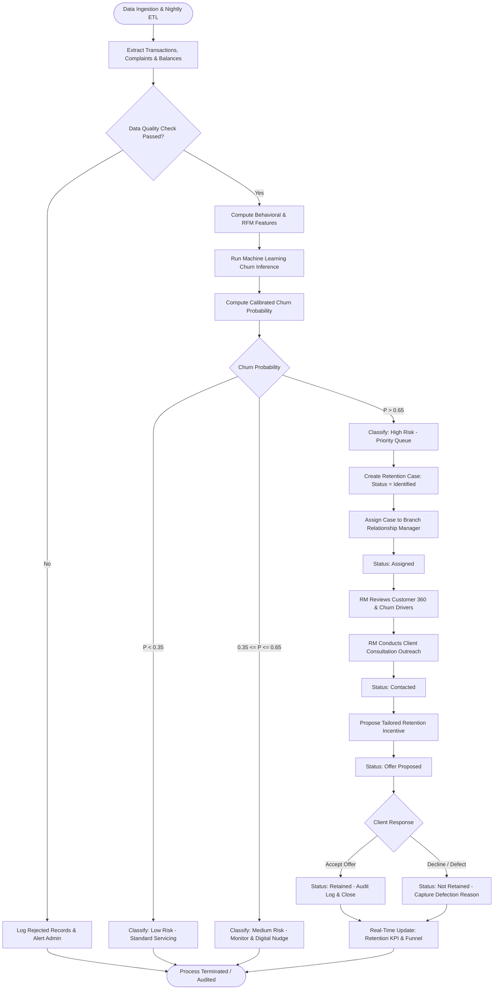
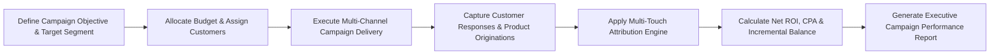

# Business Process Flow Specifications
## Project Name: BankSight — Banking Customer Intelligence & Retention Platform
**Document Version:** 1.0.0  
**Date:** 2026-11-07  

---

## 1. End-to-End Retention Management Process Flow

---

## 2. Campaign Management & Attribution Process Flow

