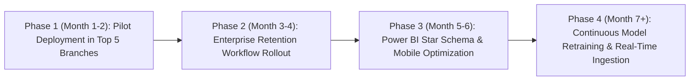

# Final Business Recommendations & Strategic Roadmap
## Project Name: BankSight — Banking Customer Intelligence & Retention Platform
**Document Version:** 1.0.0  
**Date:** 2026-11-07  

---

## 1. Executive Summary
Based on the analytical architecture, segmentation profiles, and predictive modeling capabilities delivered in **BankSight**, the following actionable business recommendations are presented to bank executive leadership, retention steering committees, and branch operations.

---

## 2. Core Strategic Recommendations

### 1. Shift from Reactive Damage Control to Preemptive Intervention
- **Action:** Enforce mandatory weekly review of the **High Churn Risk Queue** ($P(\text{churn}) > 0.65$) by branch Relationship Managers.
- **Expected Impact:** Engaging at-risk customers 60-90 days prior to formal account closure reduces customer defection by an estimated 25% to 35%, preserving up to $25M in annual retail deposits.

### 2. Tailor Retention Offers to Root Cause Drivers
- **Action:** Transition away from generic fee refunds. Utilize the BankSight customer 360 factor breakdown to match offers:
  - *Deteriorating Digital Engagement:* Offer complimentary digital onboarding concierge or premium mobile features.
  - *Balance Outflow / Rate Sensitivity:* Offer automated high-yield certificate of deposit (CD) switch with +0.35% APY bonus.
  - *Unresolved Service Complaint:* Dispatch executive outreach from Branch Manager with expedited resolution and goodwill fee credit.

### 3. Deploy Multi-Tier RFM Segmentation in Campaign Targeting
- **Action:** Align marketing campaigns strictly with RFM and K-Means clusters:
  - *Champions / High Value:* Enroll in Private Wealth advisory, exclusive rewards, and executive concierge.
  - *Potential Loyalists:* Trigger cross-sell campaigns for high-affinity credit cards or mortgages.
  - *Dormant / At-Risk:* Trigger automated micro-incentive re-activation surveys ($10 account credit for 3 mobile debit transactions).

### 4. Institute Branch Network Retention Benchmarking
- **Action:** Integrate branch attrition rates and retention SLA adherence directly into Branch Manager quarterly performance scorecards.
- **Expected Impact:** Aligns branch frontline incentives with deposit retention rather than new customer acquisition alone.

### 5. Institutionalize Power BI Self-Service Reporting
- **Action:** Distribute BankSight's star-schema datasets and standardized DAX measures across regional analytics teams to eliminate duplicate spreadsheet modeling and unify reporting definitions across the bank.

---

## 3. Phased Rollout Roadmap

