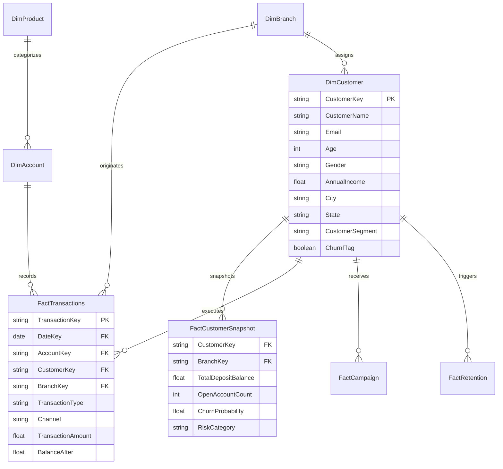

# BankSight Power BI Semantic Layer & Implementation Guide
## Enterprise Business Intelligence Star Schema & DAX Reference
**Document Version:** 1.0.0  
**Date:** 2026-11-07  

---

## 1. Architectural Overview & Star Schema
The BankSight Power BI analytics semantic layer decouples operational ACID OLTP schemas into an optimized Star Schema designed for sub-second analytical slicing, time intelligence, and DAX aggregation.

---

## 2. Model Relationship Specifications

| From Table (Many) | Foreign Key | To Table (One) | Primary Key | Cardinality | Cross Filter Direction |
|---|---|---|---|---|---|
| `FactTransactions` | `CustomerKey` | `DimCustomer` | `CustomerKey` | Many to One ($* : 1$) | Single |
| `FactTransactions` | `AccountKey` | `DimAccount` | `AccountKey` | Many to One ($* : 1$) | Single |
| `FactTransactions` | `BranchKey` | `DimBranch` | `BranchKey` | Many to One ($* : 1$) | Single |
| `FactCustomerSnapshot` | `CustomerKey` | `DimCustomer` | `CustomerKey` | Many to One ($* : 1$) | Single |
| `FactCustomerSnapshot` | `BranchKey` | `DimBranch` | `BranchKey` | Many to One ($* : 1$) | Single |
| `FactCampaign` | `CustomerKey` | `DimCustomer` | `CustomerKey` | Many to One ($* : 1$) | Single |
| `FactRetention` | `CustomerKey` | `DimCustomer` | `CustomerKey` | Many to One ($* : 1$) | Single |

---

## 3. Step-by-Step Power BI Desktop Connection Instructions

1. **Launch Power BI Desktop:**
   - Open Power BI Desktop (April 2024 or later recommended).
2. **Connect to Verified Datasets:**
   - Option A (Direct Database): Click **Get Data** -> **PostgreSQL Database** or **ODBC** (for SQLite). Enter server details and select views from `powerbi/sql_views/star_schema_views.sql`.
   - Option B (File-based Export): Click **Get Data** -> **Excel Workbook** or **Folder**, navigate to `BankSight/powerbi/datasets/`, and select `BankSight_PowerBI_Star_Schema.xlsx`.
3. **Verify Relationships:**
   - Navigate to the **Model View** tab.
   - Confirm all foreign keys auto-detect matching primary keys according to the matrix in Section 2.
4. **Import Standard DAX Measures:**
   - Create a dedicated measure table `_Measures`.
   - Copy and paste formulas from `powerbi/dax/measures.dax`.

---

## 4. Recommended Power BI Report Canvas Layouts

### Canvas Page 1: Executive Portfolio Overview
- **Header:** BankSight corporate header with date slicer and branch filter.
- **Top Metric Cards:** `Total Customers`, `Total Deposits`, `Customer Churn Rate`, `Customer Retention Rate`, `Average Customer Balance`.
- **Visual 1 (Area Chart):** Monthly Net Cashflow (`[Total Deposits]` vs `[Total Withdrawals]`).
- **Visual 2 (Donut Chart):** Customer Share by Segment (`DimCustomer[CustomerSegment]`).
- **Visual 3 (Bar Chart):** Top Branches by Total Deposits (`DimBranch[BranchName]`, `[Total Deposits]`).

### Canvas Page 2: Churn & Retention Operations
- **Top Metric Cards:** `High Risk Customer Count`, `Total Retention Cases`, `Retention Workflow Conversion Rate`.
- **Visual 1 (Scatter Plot):** Balance Trend vs Churn Probability.
- **Visual 2 (Funnel Chart):** Retention Cases by Status (`Identified` -> `Assigned` -> `Contacted` -> `Offer Proposed` -> `Retained`).
- **Visual 3 (Matrix Grid):** High-risk accounts drill-through table with assigned RM and proposed offers.

---

## 5. Refresh Strategy & Governance
- **Scheduled Refresh:** In Power BI Service, configure daily scheduled refresh at 02:00 AM UTC following nightly batch data pipeline execution.
- **Data Privacy Standard:** Datasets are 100% compliant with synthetic data confidentiality; safe for distribution across external stakeholders and cloud workspaces.
